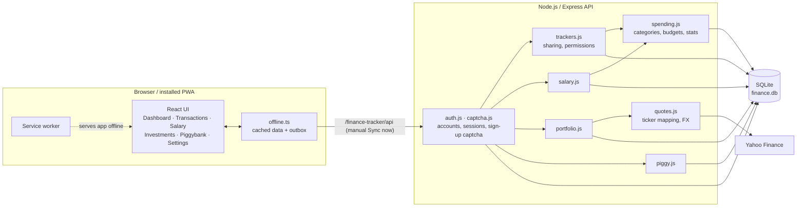

# Finance Tracker

A personal finance app: track spending against a monthly budget, follow your investment portfolio,
and keep savings in piggybank pots. One codebase works as a website and as an installable phone app (PWA)
that keeps working offline.

## Technologies

| Layer | Stack |
|-------|-------|
| Frontend | React 19, TypeScript, Vite, React Router, Recharts, vite-plugin-pwa (Workbox service worker) |
| Backend | Node.js, Express 5, `node:sqlite` (no native deps), scrypt-hashed passwords, cookie sessions |
| Data | SQLite file (`server/data/finance.db`), Yahoo Finance for quotes and FX rates |
| Deployment | Ansible, Ubuntu, nginx + Let's Encrypt, systemd, ufw, fail2ban |
| Tooling | `node --test`, oxlint, i18n checker script |

## Architecture



In production, nginx terminates HTTPS and proxies `/finance-tracker/` to Express, which also serves the built web app; `/` redirects there.

## Features

- **Spending dashboard**: money left this month, safe-to-spend per day, projected month end, per-category limits, 6-month trend.
- **Shared trackers**: create trackers (e.g. "Household") and invite people by username; each expense shows who added it.
- **Salary calculator**: earnings minus costs of earning them, saved as one monthly income and optionally as the budget.
- **Investments**: enter ticker, quantity and average price; prices refresh every 15 min and convert to your main currency.
- **Piggybank**: savings pots in any currency with daily balance history.

Also: private accounts (sign-up protected by a captcha), offline mode with manual sync, English and Polish, JSON backup and CSV export.

## Quick start

Requires Node.js 22.9 or newer (uses the built-in `node:sqlite`).

```bash
npm run install:all   # once
npm run dev           # API on :3001, web on :5173
```

Open http://localhost:5173/finance-tracker/ and register an account. Run tests with `npm test`.
Sample data: `node server/scripts/seed-demo.js` creates a `demo` account with 6 months of data and prints its password.
Production setup: see [deploy/README.md](deploy/README.md).

## Tips

1. **Set the month's budget first** ("money prepared"). Every dashboard number is calculated from it.
2. **Enter tickers with a market suffix** (`PKN.PL`, `AAPL.US`, `VWCE.DE`). They are converted to Yahoo Finance symbols for you.
3. **Offline changes are not sent automatically.** Press **Sync now** in the top bar when you're back online.
4. **Install on the phone**: Android (Chrome) ⋮ → *Install app*; iPhone (Safari) Share → *Add to Home Screen*.
   Offline loading only works from the production build.
5. **Close sign-ups** once everyone has an account: set `ALLOW_REGISTRATION=0` in `.env`.

Adding a language: copy `web/src/locales/pl.ts`, register it in `web/src/i18n.ts`,
then run `npm --prefix web run check:i18n` to find missing translations.
